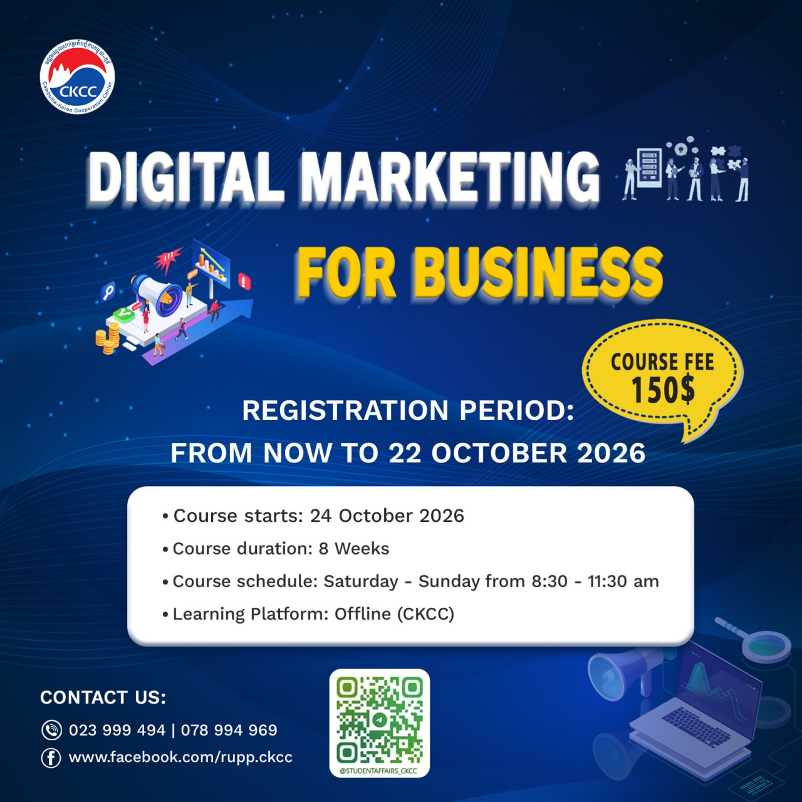
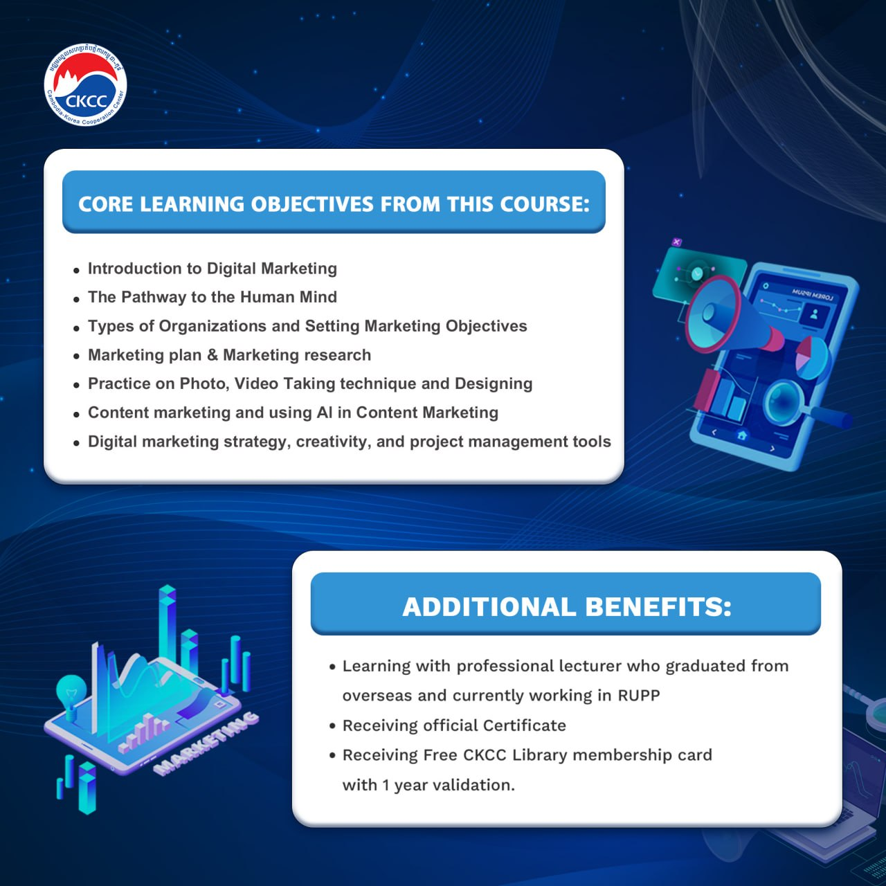

# Digital Marketing for Business – Quizzes

Interactive English–Khmer quizzes for the 8-week **Digital Marketing for Business** course.

តេស្តអន្តរកម្មជាភាសាអង់គ្លេស និងខ្មែរ សម្រាប់វគ្គសិក្សា Digital Marketing for Business។

## About the course

<p>
  
  
</p>

## Take the quiz

| Chapter | Topic                                                 | Slides                                                                                                  | Summary & Q&A (English–Khmer)                                                                                                                                                                                                                                                                                                                                                                                                                                                                                | Quiz                                                                                                                                                                                                                                                                            |
| ------- | ----------------------------------------------------- | ------------------------------------------------------------------------------------------------------- | ------------------------------------------------------------------------------------------------------------------------------------------------------------------------------------------------------------------------------------------------------------------------------------------------------------------------------------------------------------------------------------------------------------------------------------------------------------------------------------------------------------ | ------------------------------------------------------------------------------------------------------------------------------------------------------------------------------------------------------------------------------------------------------------------------------- |
| 1       | Introduction to Digital Marketing                     | [View PDF](Ch1_Introduction%20to%20Digital%20Marketing/Ch1_Introduction%20to%20Digital%20Marketing.pdf) | Summary: [Download .docx](Ch1_Introduction%20to%20Digital%20Marketing/Digital_Marketing_Ch1_Summary_English_Khmer.docx)<br>Q&A: [Download .docx](Ch1_Introduction%20to%20Digital%20Marketing/Digital_Marketing_Ch1_QA_English_Khmer.docx)<br>Review Q&A: [View online](https://oupiseyit.github.io/Digital-Marketing-for-Business/Ch1_Introduction%20to%20Digital%20Marketing/Ch1_Review_QA.html) · [.docx](Ch1_Introduction%20to%20Digital%20Marketing/Digital_Marketing_Ch1_Summary_QA_English_Khmer.docx) | [Open quiz](https://oupiseyit.github.io/Digital-Marketing-for-Business/Ch1_Introduction%20to%20Digital%20Marketing/Ch1_Quiz.html)<br>[Review quiz](https://oupiseyit.github.io/Digital-Marketing-for-Business/Ch1_Introduction%20to%20Digital%20Marketing/Ch1_Review_Quiz.html) |
| 2       | The Path to Marketing 7.0                             | [View PDF](Ch2_The%20Path%20to%20Marketing%207.0/Marketing%207.0.pdf)                                   | Summary: Coming soon<br>Q&A: [Download .docx](Ch2_The%20Path%20to%20Marketing%207.0/Digital_Marketing_Ch2_QA_English_Khmer.docx)                                                                                                                                                                                                                                                                                                                                                                             | [Open quiz](https://oupiseyit.github.io/Digital-Marketing-for-Business/Ch2_The%20Path%20to%20Marketing%207.0/Ch2_Quiz.html)                                                                                                                                                     |
| 3       | Types of Organizations & Setting Marketing Objectives | [View PDF](Ch3_Types%20of%20Organizations/Ch3_Types%20of%20Organizations.pdf)                           | Summary: Coming soon<br>Q&A: [Download .docx](Ch3_Types%20of%20Organizations/Digital_Marketing_Ch3_QA_English_Khmer.docx)                                                                                                                                                                                                                                                                                                                                                                                    | [Open quiz](https://oupiseyit.github.io/Digital-Marketing-for-Business/Ch3_Types%20of%20Organizations/Ch3_Quiz.html)                                                                                                                                                            |

## How it works

- Each chapter quiz has 30 multiple-choice questions, shown in English and Khmer. The Ch1 review quiz adds 20 deeper questions drawn from the Ch1 summary.
- Pick one answer per question. The question then locks, the correct choice turns green, and the answer appears in English and Khmer.
- The bar at the bottom shows your score and progress. **Restart** clears every answer.
- Built with plain HTML and CSS, with no JavaScript. It needs a recent browser (Chrome, Edge, Safari, or Firefox 121+).

The quiz is for self-study. The correct answers can be seen in the page source.

## Source

Questions are based on the course slides: _Ch1_Introduction to Digital Marketing.pdf_, _Marketing 7.0.pdf_ (Kotler, Kartajaya & Setiawan, 2026), and _Ch3_Types of Organizations.pdf_ (Kotler, Kartajaya & Setiawan, 2021, _Marketing 5.0_; Digital Marketing Institute, 2021). The Ch1 summary and review quiz are based on _Ch1_Introduction to Digital Marketing.pdf_.

## Editing this repo

Each chapter has its own folder with its slides, Q&A handout, and `ChN_Quiz.html`. Ch1 also has a bilingual summary, a review Q&A handout (also as the web page `Ch1_Review_QA.html`), and `Ch1_Review_Quiz.html`. All quizzes share one stylesheet, [`quiz.css`](quiz.css). Pushing to `main` updates the GitHub Pages site automatically.

A pre-commit hook formats staged HTML, CSS, Markdown, and JSON files with Prettier. To turn it on after cloning, run this once:

```bash
npm install
```

After that, commit as usual. Use `npx prettier --check .` to see which files need formatting, or `git commit --no-verify` to skip the hook for one commit.
