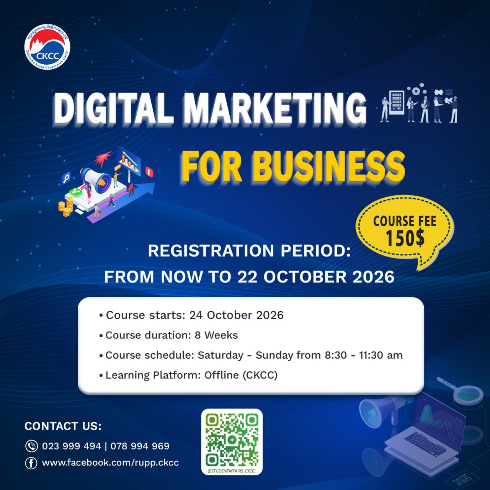
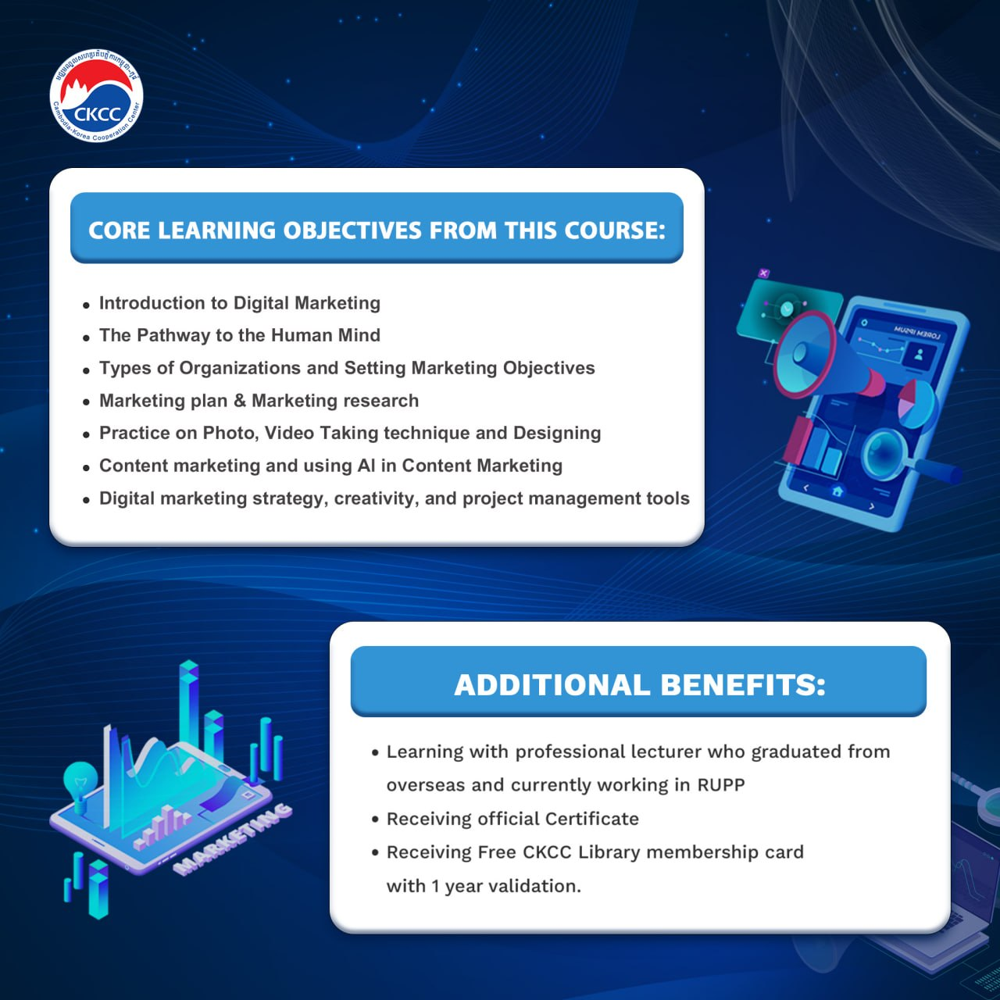

# Digital Marketing for Business – Quizzes

Interactive English–Khmer quizzes for the 8-week **Digital Marketing for Business** course.

តេស្តអន្តរកម្មជាភាសាអង់គ្លេស និងខ្មែរ សម្រាប់វគ្គសិក្សា Digital Marketing for Business។

## About the course

<p>
  
  
</p>

## Chapters

| Chapter | Topic                                                 | Slides                                                                                                              | Summary & Q&A (English–Khmer)                                                                                                                                                                                                                                                                                                                                                                                                                                                                                                                                                                                                                                                                                                                                                                                                                        | Learn Q&A                                                                                                                                                                                                                                                                                                         | Quiz                                                                                                                                                                                                                                                                            |
| ------- | ----------------------------------------------------- | ------------------------------------------------------------------------------------------------------------------- | ---------------------------------------------------------------------------------------------------------------------------------------------------------------------------------------------------------------------------------------------------------------------------------------------------------------------------------------------------------------------------------------------------------------------------------------------------------------------------------------------------------------------------------------------------------------------------------------------------------------------------------------------------------------------------------------------------------------------------------------------------------------------------------------------------------------------------------------------------- | ----------------------------------------------------------------------------------------------------------------------------------------------------------------------------------------------------------------------------------------------------------------------------------------------------------------- | ------------------------------------------------------------------------------------------------------------------------------------------------------------------------------------------------------------------------------------------------------------------------------- |
| 1       | Introduction to Digital Marketing                     | [View PDF](Ch1_Introduction%20to%20Digital%20Marketing/Ch1_Introduction%20to%20Digital%20Marketing.pdf)             | Summary: [Download .docx](Ch1_Introduction%20to%20Digital%20Marketing/Digital_Marketing_Ch1_Summary_English_Khmer.docx) · [Download PDF](Ch1_Introduction%20to%20Digital%20Marketing/Digital_Marketing_Ch1_Summary_English_Khmer.pdf)<br>Q&A: [Download .docx](Ch1_Introduction%20to%20Digital%20Marketing/Digital_Marketing_Ch1_QA_English_Khmer.docx) · [Download PDF](Ch1_Introduction%20to%20Digital%20Marketing/Digital_Marketing_Ch1_QA_English_Khmer.pdf)<br>Review Q&A: [View online](https://oupiseyit.github.io/Digital-Marketing-for-Business/Ch1_Introduction%20to%20Digital%20Marketing/Ch1_Review_QA.html) · [.docx](Ch1_Introduction%20to%20Digital%20Marketing/Digital_Marketing_Ch1_Summary_QA_English_Khmer.docx) · [Download PDF](Ch1_Introduction%20to%20Digital%20Marketing/Digital_Marketing_Ch1_Summary_QA_English_Khmer.pdf) | [Learn quiz](https://oupiseyit.github.io/Digital-Marketing-for-Business/learn.html?quiz=Ch1_Introduction%20to%20Digital%20Marketing/Ch1_Quiz.html)<br>[Learn review](https://oupiseyit.github.io/Digital-Marketing-for-Business/learn.html?quiz=Ch1_Introduction%20to%20Digital%20Marketing/Ch1_Review_Quiz.html) | [Open quiz](https://oupiseyit.github.io/Digital-Marketing-for-Business/Ch1_Introduction%20to%20Digital%20Marketing/Ch1_Quiz.html)<br>[Review quiz](https://oupiseyit.github.io/Digital-Marketing-for-Business/Ch1_Introduction%20to%20Digital%20Marketing/Ch1_Review_Quiz.html) |
| 2       | The Path to Marketing 7.0                             | [View PDF](Ch2_The%20Path%20to%20Marketing%207.0/Marketing%207.0.pdf)                                               | Summary: [Download .docx](Ch2_The%20Path%20to%20Marketing%207.0/Digital_Marketing_Ch2_Summary_English_Khmer.docx) · [Download PDF](Ch2_The%20Path%20to%20Marketing%207.0/Digital_Marketing_Ch2_Summary_English_Khmer.pdf)<br>Q&A: [Download .docx](Ch2_The%20Path%20to%20Marketing%207.0/Digital_Marketing_Ch2_QA_English_Khmer.docx) · [Download PDF](Ch2_The%20Path%20to%20Marketing%207.0/Digital_Marketing_Ch2_QA_English_Khmer.pdf)                                                                                                                                                                                                                                                                                                                                                                                                             | [Open Learn Q&A](https://oupiseyit.github.io/Digital-Marketing-for-Business/learn.html?quiz=Ch2_The%20Path%20to%20Marketing%207.0/Ch2_Quiz.html)                                                                                                                                                                  | [Open quiz](https://oupiseyit.github.io/Digital-Marketing-for-Business/Ch2_The%20Path%20to%20Marketing%207.0/Ch2_Quiz.html)                                                                                                                                                     |
| 3       | Types of Organizations & Setting Marketing Objectives | [View PDF](Ch3_Types%20of%20Organizations/Ch3_Types%20of%20Organizations.pdf)                                       | Summary: [Download .docx](Ch3_Types%20of%20Organizations/Digital_Marketing_Ch3_Summary_English_Khmer.docx) · [Download PDF](Ch3_Types%20of%20Organizations/Digital_Marketing_Ch3_Summary_English_Khmer.pdf)<br>Q&A: [Download .docx](Ch3_Types%20of%20Organizations/Digital_Marketing_Ch3_QA_English_Khmer.docx) · [Download PDF](Ch3_Types%20of%20Organizations/Digital_Marketing_Ch3_QA_English_Khmer.pdf)                                                                                                                                                                                                                                                                                                                                                                                                                                         | [Learn quiz](https://oupiseyit.github.io/Digital-Marketing-for-Business/learn.html?quiz=Ch3_Types%20of%20Organizations/Ch3_Quiz.html)<br>[Learn review](https://oupiseyit.github.io/Digital-Marketing-for-Business/learn.html?quiz=Ch3_Types%20of%20Organizations/Ch3_Review_Quiz.html)                           | [Open quiz](https://oupiseyit.github.io/Digital-Marketing-for-Business/Ch3_Types%20of%20Organizations/Ch3_Quiz.html)<br>[Review quiz](https://oupiseyit.github.io/Digital-Marketing-for-Business/Ch3_Types%20of%20Organizations/Ch3_Review_Quiz.html)                           |
| 4       | Marketing Plan & Marketing Research                   | [View PDF](Ch4_Marketing%20Plan%20%26%20Marketing%20Research/Ch4_Marketing%20Plan%20%26%20Marketing%20Research.pdf) | Summary: [Download .docx](Ch4_Marketing%20Plan%20%26%20Marketing%20Research/Digital_Marketing_Ch4_Summary_English_Khmer.docx) · [Download PDF](Ch4_Marketing%20Plan%20%26%20Marketing%20Research/Digital_Marketing_Ch4_Summary_English_Khmer.pdf)<br>Q&A: [Download .docx](Ch4_Marketing%20Plan%20%26%20Marketing%20Research/Digital_Marketing_Ch4_QA_English_Khmer.docx) · [Download PDF](Ch4_Marketing%20Plan%20%26%20Marketing%20Research/Digital_Marketing_Ch4_QA_English_Khmer.pdf)                                                                                                                                                                                                                                                                                                                                                             | [Open Learn Q&A](https://oupiseyit.github.io/Digital-Marketing-for-Business/learn.html?quiz=Ch4_Marketing%20Plan%20%26%20Marketing%20Research/Ch4_Quiz.html)                                                                                                                                                      | [Open quiz](https://oupiseyit.github.io/Digital-Marketing-for-Business/Ch4_Marketing%20Plan%20%26%20Marketing%20Research/Ch4_Quiz.html)                                                                                                                                         |

## Books

Further reading for the course:

| Book                                                                             | Author(s)                                         | Slides      | Summary & Q&A (English–Khmer)                                                                                                                                                                                         | Learn Q&A                                                                                                                                 | Quiz                                                                                                                 |
| -------------------------------------------------------------------------------- | ------------------------------------------------- | ----------- | --------------------------------------------------------------------------------------------------------------------------------------------------------------------------------------------------------------------- | ----------------------------------------------------------------------------------------------------------------------------------------- | -------------------------------------------------------------------------------------------------------------------- |
| _Marketing 5.0: Technology for Humanity_ (2021)                                  | Philip Kotler, Hermawan Kartajaya & Iwan Setiawan | —           | Summary: Coming soon<br>Q&A: [Download .docx](Book_Marketing%205.0/Digital_Marketing_Marketing_5_0_QA_English_Khmer.docx) · [Download PDF](Book_Marketing%205.0/Digital_Marketing_Marketing_5_0_QA_English_Khmer.pdf) | [Open Learn Q&A](https://oupiseyit.github.io/Digital-Marketing-for-Business/learn.html?quiz=Book_Marketing%205.0/Marketing_5_0_Quiz.html) | [Open quiz](https://oupiseyit.github.io/Digital-Marketing-for-Business/Book_Marketing%205.0/Marketing_5_0_Quiz.html) |
| _Marketing 6.0: The Future Is Immersive_ (2023)                                  | Philip Kotler, Hermawan Kartajaya & Iwan Setiawan | —           | Summary: Coming soon<br>Q&A: [Download .docx](Book_Marketing%206.0/Digital_Marketing_Marketing_6_0_QA_English_Khmer.docx) · [Download PDF](Book_Marketing%206.0/Digital_Marketing_Marketing_6_0_QA_English_Khmer.pdf) | [Open Learn Q&A](https://oupiseyit.github.io/Digital-Marketing-for-Business/learn.html?quiz=Book_Marketing%206.0/Marketing_6_0_Quiz.html) | [Open quiz](https://oupiseyit.github.io/Digital-Marketing-for-Business/Book_Marketing%206.0/Marketing_6_0_Quiz.html) |
| _Marketing 7.0: A Guide for Thinking Marketers in the Age of AI_ (2026)          | Philip Kotler, Hermawan Kartajaya & Iwan Setiawan | —           | Summary: Coming soon<br>Q&A: [Download .docx](Book_Marketing%207.0/Digital_Marketing_Marketing_7_0_QA_English_Khmer.docx) · [Download PDF](Book_Marketing%207.0/Digital_Marketing_Marketing_7_0_QA_English_Khmer.pdf) | [Open Learn Q&A](https://oupiseyit.github.io/Digital-Marketing-for-Business/learn.html?quiz=Book_Marketing%207.0/Marketing_7_0_Quiz.html) | [Open quiz](https://oupiseyit.github.io/Digital-Marketing-for-Business/Book_Marketing%207.0/Marketing_7_0_Quiz.html) |
| _Key Performance Indicators: The 75 Measures Every Manager Needs to Know_ (2012) | Bernard Marr                                      | Coming soon | Coming soon                                                                                                                                                                                                           | Coming soon                                                                                                                               | Coming soon                                                                                                          |

## Strategy

Books on marketing strategy (English, with Khmer editions):

| Book                                      | Author(s)                     | Slides | Summary & Q&A (English–Khmer)                                                                                                                                                                                                                 | Learn Q&A                                                                                                                                             | Quiz                                                                                                                             |
| ----------------------------------------- | ----------------------------- | ------ | --------------------------------------------------------------------------------------------------------------------------------------------------------------------------------------------------------------------------------------------- | ----------------------------------------------------------------------------------------------------------------------------------------------------- | -------------------------------------------------------------------------------------------------------------------------------- |
| _Blue Ocean Shift_ · វិថីសមុទ្រខៀវ (2017) | W. Chan Kim & Renée Mauborgne | —      | Summary: Coming soon<br>Q&A: [Download .docx](Strategy_Blue%20Ocean%20Shift/Digital_Marketing_Blue_Ocean_Shift_QA_English_Khmer.docx) · [Download PDF](Strategy_Blue%20Ocean%20Shift/Digital_Marketing_Blue_Ocean_Shift_QA_English_Khmer.pdf) | [Open Learn Q&A](https://oupiseyit.github.io/Digital-Marketing-for-Business/learn.html?quiz=Strategy_Blue%20Ocean%20Shift/Blue_Ocean_Shift_Quiz.html) | [Open quiz](https://oupiseyit.github.io/Digital-Marketing-for-Business/Strategy_Blue%20Ocean%20Shift/Blue_Ocean_Shift_Quiz.html) |
| _Purple Cow_ · គោពណ៌ស្វាយ (2003)          | Seth Godin                    | —      | Summary: Coming soon<br>Q&A: [Download .docx](Strategy_Purple%20Cow/Digital_Marketing_Purple_Cow_QA_English_Khmer.docx) · [Download PDF](Strategy_Purple%20Cow/Digital_Marketing_Purple_Cow_QA_English_Khmer.pdf)                             | [Open Learn Q&A](https://oupiseyit.github.io/Digital-Marketing-for-Business/learn.html?quiz=Strategy_Purple%20Cow/Purple_Cow_Quiz.html)               | [Open quiz](https://oupiseyit.github.io/Digital-Marketing-for-Business/Strategy_Purple%20Cow/Purple_Cow_Quiz.html)               |

## How it works

- Each chapter quiz has 30 multiple-choice questions, shown in English and Khmer. The Ch1 and Ch3 review quizzes add 20 deeper questions each, drawn from the chapter summaries.
- Pick one answer per question. You can change your answers until you finish; nothing is marked yet.
- Above the questions, choose **Language · ភាសា**: English + ខ្មែរ (default), ខ្មែរ only, or English only. This switches the questions, options, and answers. Your choice is remembered for the other quizzes.
- Tick **Random questions · សំណួរចៃដន្យ** or **Random options · ជម្រើសចៃដន្យ** to shuffle the order. **Restart** reshuffles.
- **Learn Q&A** uses the same questions for study: each question is shown with its answer in English and Khmer, without the multiple-choice options. Tick **Random questions** to shuffle the order.
- The bar at the bottom shows how many questions you've answered. **Show results** becomes available once every question has an answer.
- Pressing **Show results** locks your answers, shows your score, marks each answer right (green) or wrong (red), and shows the correct answer in English and Khmer. **Restart** clears everything.
- Quizzes are mostly plain HTML and CSS. A small script, `quiz.js`, adds the language and shuffle options and keeps **Show results** locked until every question is answered (Learn Q&A also uses a little JavaScript to load and shuffle the questions). It needs a recent browser (Chrome, Edge, Safari, or Firefox 121+).

The quiz is for self-study. The correct answers can be seen in the page source.

## Source

Questions are based on the course slides: _Ch1_Introduction to Digital Marketing.pdf_, _Marketing 7.0.pdf_ (Kotler, Kartajaya & Setiawan, 2026), _Ch3_Types of Organizations.pdf_ (Kotler, Kartajaya & Setiawan, 2021, _Marketing 5.0_; Digital Marketing Institute, 2021), and _Ch4_Marketing Plan & Marketing Research.pdf_ (Marshall & Johnson, 2019, _Marketing Management_; Chaffey, _E-Business and E-Commerce Management_; Cambodia 4.0, 2021). The Ch1 summary and review quiz are based on _Ch1_Introduction to Digital Marketing.pdf_.

## Editing this repo

Each chapter has its own folder with its slides, Q&A handout, and `ChN_Quiz.html`. [`learn.html`](learn.html) at the root is the Learn Q&A page: it reads a quiz page's questions via `learn.html?quiz=<folder>/<ChN_Quiz.html>`, so new quizzes need only a README link. Ch1 also has a bilingual summary, a review Q&A handout (also as the web page `Ch1_Review_QA.html`), and `Ch1_Review_Quiz.html`. All quizzes share one stylesheet, [`quiz.css`](quiz.css), and one script, [`quiz.js`](quiz.js). Pushing to `main` updates the GitHub Pages site automatically.

A pre-commit hook formats staged HTML, CSS, Markdown, and JSON files with Prettier. To turn it on after cloning, run this once:

```bash
npm install
```

After that, commit as usual. Use `npx prettier --check .` to see which files need formatting, or `git commit --no-verify` to skip the hook for one commit.
